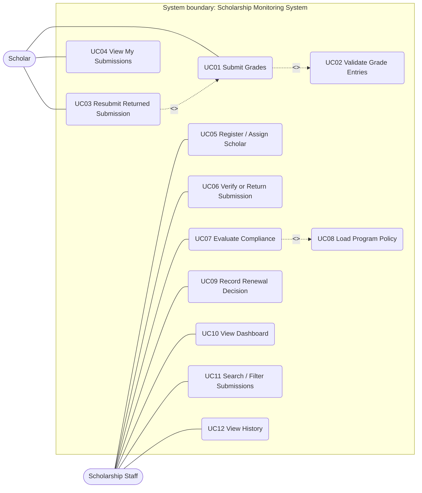
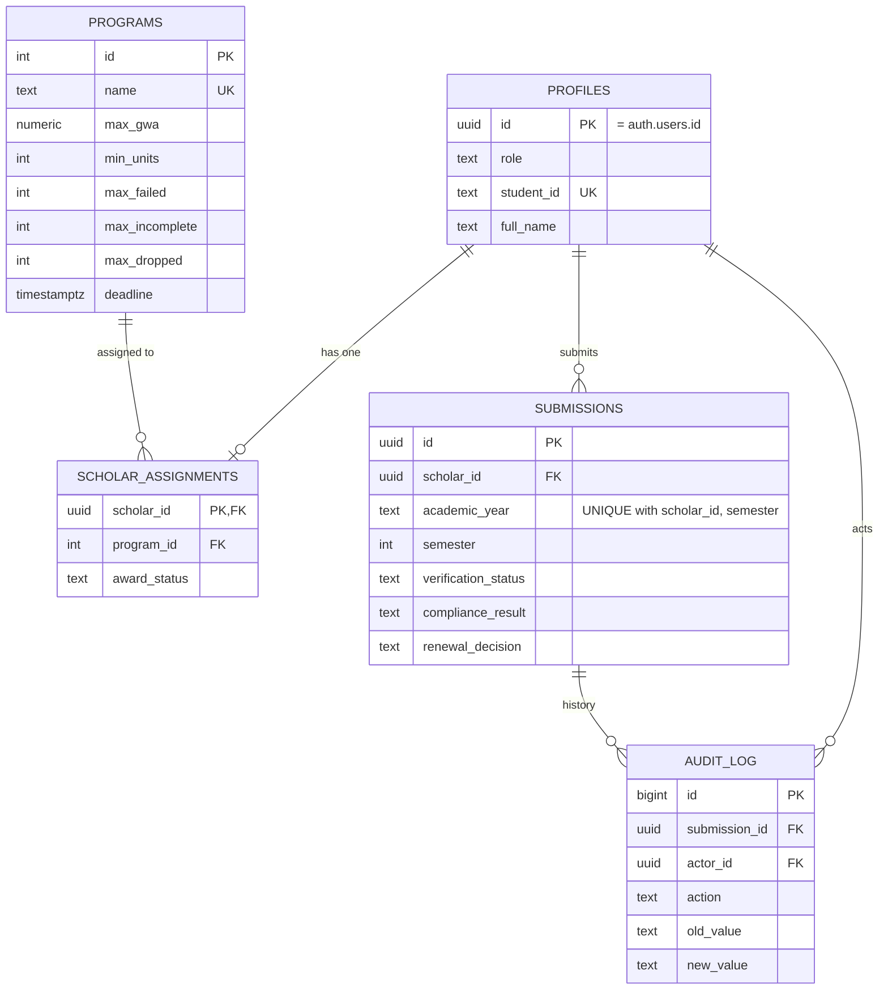

# Student Scholarship Monitoring and Academic Compliance System — Analysis & Design

Roles: **Scholar**, **Scholarship Staff**. Programs: **Merit**, **Community**. The Registrar is the source of official grades (external, not a system actor). The system never alters grades and never releases payments.

Three separate statuses (never merged):
- **Submission status**: Pending / Verified / Returned
- **Academic compliance**: Not Evaluated / Compliant / With Deficiency
- **Award status**: Active / Probation / Suspended / Terminated / Graduated (changed only by staff decision, never automatically)

Grading: 1.00 best, 3.00 passing, 5.00 failing. Deadline: 2026-10-30 17:00 Asia/Manila (exactly 17:00:00 = on time).

---
## A1. Problem Analysis
**Problem statement.** Scholarship staff track scholars' grades, deadlines and policy compliance by hand from spreadsheets and paper. Checks are inconsistent between the Merit and Community programs, late or unverified records slip through, and there is no reliable history of who decided what.

| ID | Problem | Cause | Effect |
|---|---|---|---|
| P1 | Inconsistent compliance results | Thresholds applied manually from memory | Unfair renewals, disputes |
| P2 | Late submissions not detected | No timestamp/deadline control | Policy violations unnoticed |
| P3 | Unverified grades used in decisions | No verification step before evaluation | Decisions based on wrong data |
| P4 | No decision trail | Edits in spreadsheets, no history | Cannot audit or defend decisions |

**Scope.** Grade submission, staff verification/return, policy-based compliance evaluation, renewal decision recording, dashboard/search, audit history, role-based access.
**Exclusions.** Changing official grades, payment/disbursement, Registrar integration (grades entered with evidence reference), admissions/application, email/SMS notifications.

**Development tasks.** T1 schema + RLS; T2 scholar submission screens; T3 staff verification/evaluation/decision; T4 dashboard, search, history, and testing.

| Risk | Response |
|---|---|
| R1 Scholar enters wrong grades | Staff verify against Registrar evidence ref; Return with reason |
| R2 Policy thresholds change | Thresholds/deadline stored in `programs` table, not code |

---
## A2. Stakeholders and Elicitation
| Stakeholder | System actor? | Interest |
|---|---|---|
| Scholar | **Yes** | Submit grades, see status |
| Scholarship Staff | **Yes** | Verify, evaluate, decide |
| Registrar | No (external source of grades) | Official grade source |
| Scholarship Committee / Sponsor | No (consumes reports/decisions) | Program outcomes |

**Elicitation questions (open-ended)**
1. How do you currently verify submitted grades against Registrar records, and what makes you return one?
2. What happens when a submission arrives at, or just after, the deadline?
3. Under what circumstances are policy exceptions granted, and who approves them?
4. Who should be able to see or change a scholar's records, and what should scholars never see or edit?
5. What reports do you need at the end of each semester and how often?
6. How should a deficiency be handled before a renewal decision is made?

---
## A3. Requirements
**Functional**
| ID | Requirement | Test |
|---|---|---|
| FR01 | Users log in with email/password; role determines screens | TC08 |
| FR02 | Staff register a scholar and assign exactly one program | TC03 |
| FR03 | Scholar submits GWA, units, failed/INC/dropped, evidence ref per AY+semester (evidence reference mandatory) | TC07 |
| FR04 | System rejects invalid values (GWA outside 1.00–5.00, negative counts) and duplicate AY+semester | TC07 |
| FR05 | Scholar sees own submissions, statuses and return reason | TC09 |
| FR06 | Staff verify a Pending submission or Return it with mandatory reason | TC06 |
| FR07 | Scholar may resubmit only a Returned submission; status resets to Pending | TC09 |
| FR08 | Staff evaluate Verified submissions only against the assigned program's thresholds, showing each check and deficiency reason | TC01–TC06 |
| FR09 | Staff record Approved/Held with note; Approved only if Compliant | TC10 |
| FR10 | Staff dashboard totals (assigned, pending, compliant, with deficiency) per semester, search by ID/name, filter by program/compliance, and history | TC09 |

**Non-functional (measurable)**
- NFR01 Evaluation of one submission completes in ≤ 2 s.
- NFR02 Dashboard loads ≤ 3 s for 500 submissions.
- NFR03 100% of status changes recorded in audit log with actor and timestamp.
- NFR04 0 scholar-accessible reads/writes of another scholar's rows (RLS verified).

**Business rules**
- BR01 (role access) Scholars access only their own records; staff read/update all.
- BR02 (verification) Only Verified submissions may be evaluated; Returned requires a reason.
- BR03 (policy selection) Thresholds come from the scholar's assigned program (Merit: GWA ≤ 1.75, units ≥ 18, 0 failed/INC/dropped. Community: GWA ≤ 2.25, units ≥ 15, 0 failed, 0 INC, ≤ 1 dropped). Late = after deadline.
- BR04 (duplicate prevention) One submission per scholar + academic year + semester; one program per scholar.
- BR05 (renewal authority) Only staff record renewal decisions; Approved requires Compliant.
- BR06 (non-automatic outcome) A deficiency flag never auto-disqualifies or changes award status; the system does not alter grades or release payments.

---
## A4. Use Case Diagram
Authentication is a precondition of every use case (not drawn as an include).

**Justification**
- UC01 «include» UC02: validation always happens on every submission (GWA range, counts ≥ 0, duplicate check).
- UC07 «include» UC08: every evaluation must read thresholds from the programs table (no hardcoded values).
- UC03 «extend» UC01: resubmission is optional behaviour that applies only when a submission is Returned.

---
## A5. Detailed Use Cases
### UC01 Submit Grades
| Item | Detail |
|---|---|
| Actor | Scholar |
| Trigger | Scholar opens the submit form for a term |
| Preconditions | Logged in as Scholar; assigned to a program |
| Main flow | 1. Scholar enters AY, semester, GWA, units, failed, INC, dropped, evidence ref. 2. System validates ranges (UC02). 3. System checks no existing submission for AY+semester. 4. System stores it with submitted_at = server time, Pending, Not Evaluated, renewal None. 5. System writes an audit entry and shows it under My Submissions. |
| Alternative | A1 (step 3) A Returned submission exists → UC03 resubmit updates it and resets to Pending. |
| Exceptions | E1 Invalid value → rejected, message shown. E2 Duplicate non-Returned submission → rejected. E3 Not assigned → insert denied by RLS. |
| Postcondition | One Pending submission exists; compliance and renewal untouched by scholar. |
| Links | FR03, FR04, FR07; BR01, BR04 |

### UC07 Evaluate Compliance
| Item | Detail |
|---|---|
| Actor | Scholarship Staff |
| Trigger | Staff selects Evaluate on a submission |
| Preconditions | Logged in as Staff; submission is **Verified** |
| Main flow | 1. Staff chooses Evaluate. 2. System loads the scholar's program thresholds and deadline (UC08). 3. System checks GWA, units, failed, INC, dropped. 4. System checks submitted_at ≤ deadline (exact deadline = on time). 5. System sets compliance = Compliant if all pass, else With Deficiency with reasons. 6. System shows each check and logs the change. |
| Alternative | A1 Re-evaluate after policy update → result overwritten and logged. |
| Exceptions | E1 Not Verified → blocked with message. E2 No program assigned → error. |
| Postcondition | compliance_result and deficiency_reasons set; submission status, grades and award status unchanged. |
| Links | FR08; BR02, BR03, BR06 |

### ERD

Cardinalities: a profile has 0..1 assignment (scholars only); a program has 0..* assignments; a profile has 0..* submissions; a submission has 0..* history entries. Full columns in `supabase/migrations/001_schema.sql`.

---
## A6. Traceability Matrix
| FR | Actor | Use case | BR | Screen / function | Test | Expected result |
|---|---|---|---|---|---|---|
| FR03/FR04 | Scholar | UC01 | BR04 | Scholar form; `submissions` UNIQUE + CHECK | TC07 | Duplicate AY+sem rejected |
| FR06 | Staff | UC06 | BR02 | Staff table; `verify_submission` | TC06 | A06 Pending cannot be evaluated until verified |
| FR08 | Staff | UC07 | BR03, BR06 | Evaluate button; `evaluate_submission` | TC01–TC05 | A01 Compliant, A02 GWA, A04 units+INC, A05 failed+late |
| FR09 | Staff | UC09 | BR05 | Approve/Hold; `record_decision` | TC10 | Approve on With Deficiency blocked; scholar cannot change decision |

**Planned but not implemented:** email/SMS notifications; CSV/PDF report export; Registrar data import/integration; staff UI to change award status (Probation/Suspended); in-app creation of auth accounts (needs a service-role backend); pagination for large data sets.
